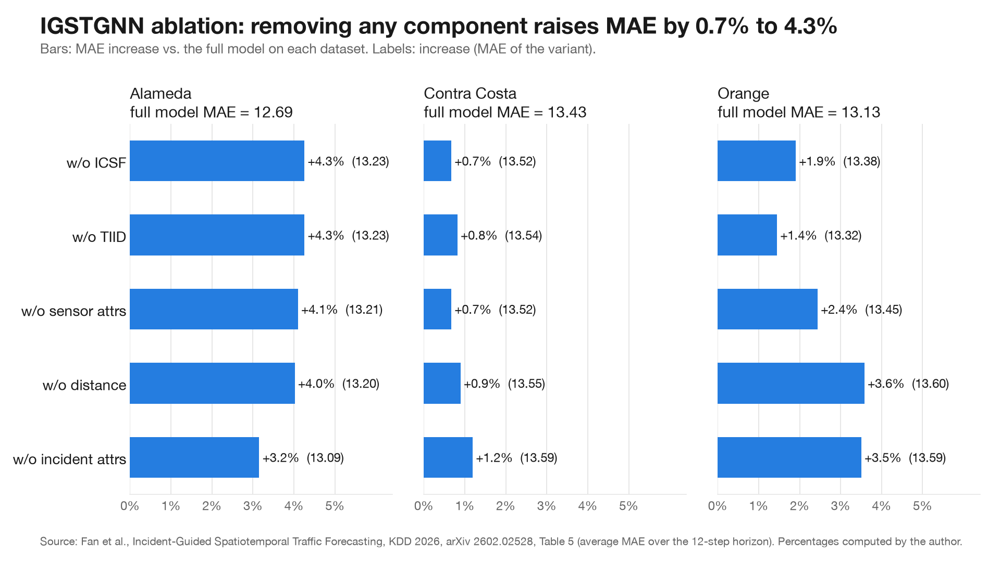
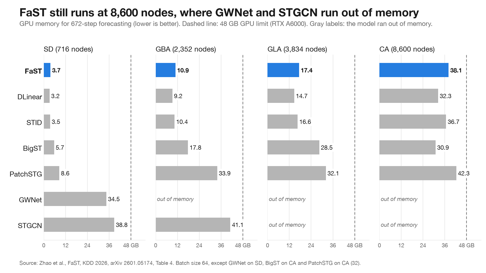

# Data Mining in Transportation Networks with Graph Neural Networks

CMPE 255 (Data Mining), San Jose State University. Short Story assignment (individual).

## Deliverables

| Item | Link |
|------|------|
| Medium article | TODO |
| Slides (SlideShare) | TODO |
| Slides (PDF/PPT in this repo) | TODO: `slides/` |
| Video (10-15 min) | TODO: `video/` or YouTube link |

## Summary

TODO: 3-5 sentences in my own words on what this story covers and what I concluded.

## Why data mining?

TODO: Why this topic belongs in a data mining course (graph-structured data, spatio-temporal pattern mining, prediction, evaluation).

## Papers covered

**Main paper (deep reading)**

- [1] J. Xue, R. Tan, J. Ma, S. V. Ukkusuri. *Data Mining in Transportation Networks with Graph Neural Networks: A Review and Outlook.* arXiv:2501.16656, 2025 (preprint). [arXiv](https://arxiv.org/abs/2501.16656)

**Supplementary papers (evidence: architecture, ablation, metrics)**

- [2] L. Fan, B. Li, T. Zou, J. Ye, B. Du. *Incident-Guided Spatiotemporal Traffic Forecasting* (IGSTGNN). KDD 2026. arXiv:2602.02528. [arXiv](https://arxiv.org/abs/2602.02528) · [code](https://github.com/fanlixiang/IGSTGNN)
- [3] Y. Zhao, Z. Zhong, A. Wang, H. Wen, M. Jin, Y. Liang, H. Wan, H. Wu. *FaST: Efficient and Effective Long-Horizon Forecasting for Large-Scale Spatial-Temporal Graphs via Mixture-of-Experts.* KDD 2026. arXiv:2601.05174. [arXiv](https://arxiv.org/abs/2601.05174)

**Surveys for context**

- [4] Y. Liang, H. Wen, Y. Xia, M. Jin, B. Yang, et al. *Foundation Models for Spatio-Temporal Data Science: A Tutorial and Survey.* arXiv:2503.13502, 2025. [arXiv](https://arxiv.org/abs/2503.13502)
- [5] Q. Zhang, H. Wang, C. Long, L. Su, X. He, et al. *A Survey of Generative Techniques for Spatial-Temporal Data Mining.* arXiv:2405.09592, 2024. [arXiv](https://arxiv.org/abs/2405.09592)

## Figures

Charts made from numbers in the papers (script: [`figures/make_charts.py`](figures/make_charts.py)).





## Repository layout

```
.
├── README.md
├── figures/   # diagrams and charts used in the article and slides (+ make_charts.py)
├── slides/    # slide outline, PDF/PPT export
└── video/     # video file (or link in this README)
```

## References

Papers [1] to [5] are listed above. Other works cited in the article and slides:

- [6] A. Derrow-Pinion, J. She, D. Wong, O. Lange, T. Hester, et al. *ETA Prediction with Graph Neural Networks in Google Maps.* arXiv:2108.11482, 2021. [arXiv](https://arxiv.org/abs/2108.11482)
- [7] T. N. Kipf, M. Welling. *Semi-Supervised Classification with Graph Convolutional Networks* (GCN). arXiv:1609.02907, 2016. [arXiv](https://arxiv.org/abs/1609.02907)
- [8] P. Veličković, G. Cucurull, A. Casanova, A. Romero, P. Liò, Y. Bengio. *Graph Attention Networks* (GAT). arXiv:1710.10903, 2017. [arXiv](https://arxiv.org/abs/1710.10903)
- [9] W. L. Hamilton, R. Ying, J. Leskovec. *Inductive Representation Learning on Large Graphs* (GraphSAGE). arXiv:1706.02216, 2017. [arXiv](https://arxiv.org/abs/1706.02216)
- [10] K. Xu, W. Hu, J. Leskovec, S. Jegelka. *How Powerful are Graph Neural Networks?* (GIN). arXiv:1810.00826, 2018. [arXiv](https://arxiv.org/abs/1810.00826)
- [11] Z. Shao, Z. Zhang, F. Wang, W. Wei, Y. Xu. *Spatial-Temporal Identity: A Simple yet Effective Baseline for Multivariate Time Series Forecasting* (STID). arXiv:2208.05233, 2022. [arXiv](https://arxiv.org/abs/2208.05233)
- [12] S. Zhang, Y. Liu, Y. Sun, N. Shah. *Graph-less Neural Networks: Teaching Old MLPs New Tricks via Distillation* (GLNN). arXiv:2110.08727, 2021. [arXiv](https://arxiv.org/abs/2110.08727)
- [13] X. Liu, Y. Xia, Y. Liang, J. Hu, Y. Wang, et al. *LargeST: A Benchmark Dataset for Large-Scale Traffic Forecasting.* arXiv:2306.08259, 2023. [arXiv](https://arxiv.org/abs/2306.08259)
- [14] X. Gou, Z. Li, T. Lan, J. Lin, Z. Li, et al. *TraffiDent: A Dataset for Understanding the Interplay Between Traffic Dynamics and Incidents* (cited in [2] as *XTraffic: A Dataset Where Traffic Meets Incidents with Explainability and More*). arXiv:2407.11477, 2024. [arXiv](https://arxiv.org/abs/2407.11477)
- [15] Y. Fang, Y. Liang, B. Hui, Z. Shao, L. Deng, X. Liu, X. Jiang, K. Zheng. *Efficient Large-Scale Traffic Forecasting with Transformers: A Spatial Data Management Perspective* (PatchSTG). KDD 2025. arXiv:2412.09972. [arXiv](https://arxiv.org/abs/2412.09972)

Original figures and charts in this repository were made by the author from the numbers reported in the papers above, unless a caption says otherwise.
